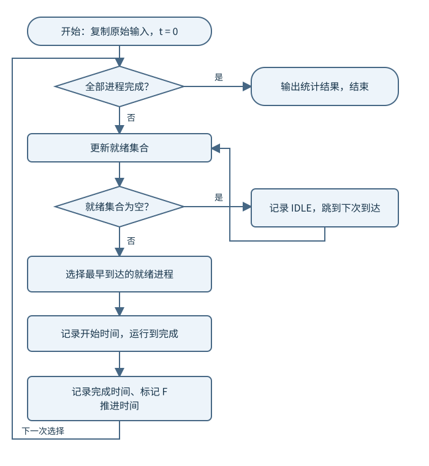
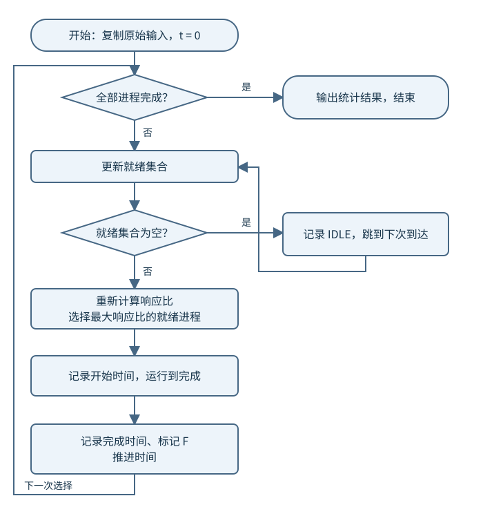
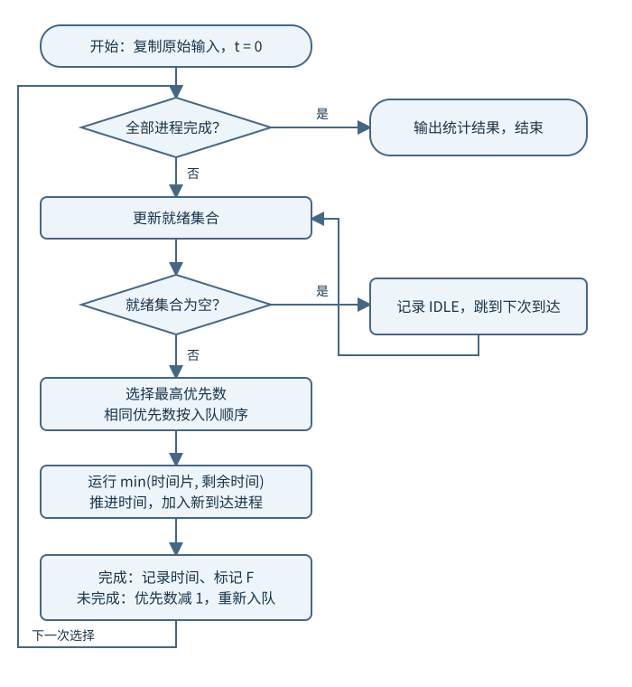

实验四：进程调度算法模拟
============================================================

本次实验继续使用实验一配置好的 ``xv6-riscv`` 环境，在 xv6 中编写 C 用户程序 ``schedsim``，
模拟单处理机上的四种调度算法：先来先服务（FCFS）、最短作业优先（SJF）、
最高响应比优先（HRRN）和基于最高优先数的循环轮转调度。

本实验中的“进程”由程序内的 PCB 数据结构表示，时间由程序中的变量推进。
四种算法决定的是 **模拟进程的运行顺序**。``schedsim`` 本身是一个真实的 xv6 用户进程，
仍由 xv6 内核调度。本实验只修改用户程序和 ``Makefile``，无需添加系统调用或修改内核调度器。

.. raw:: html

   <nav class="lab-progress" aria-label="实验流程">
     <a href="#lab4-goals">01实验目标</a>
     <a href="#lab4-prepare">02实验准备</a>
     <a href="#lab4-model">03调度模型</a>
     <a href="#lab4-tasks">04算法实现</a>
     <a href="#lab4-tests">05测试比较</a>
     <a href="#lab4-report">06报告提交</a>
   </nav>

.. _lab4-goals:

实验目标
~~~~~~~~~~~~~~~~~~~~~~~~~~~~~~~~~~~~~~~~~~~~~~~~~~~~~~~~~~~~

完成本次实验后，应能够：

* 使用 PCB 保存模拟进程的到达时间、服务时间、优先数和运行状态；
* 根据当前就绪进程集合实现四种调度选择规则；
* 区分非抢占式调度与按时间片重新选择进程的调度；
* 正确处理 CPU 空闲、进程陆续到达、并列选择和多次运行；
* 计算等待时间、周转时间和带权周转时间；
* 使用同一组数据比较四种算法的平均周转时间和平均带权周转时间。

.. _lab4-prepare:

实验准备
~~~~~~~~~~~~~~~~~~~~~~~~~~~~~~~~~~~~~~~~~~~~~~~~~~~~~~~~~~~~

在 Ubuntu 或服务器终端进入已有 xv6-riscv 仓库。先检查已有修改，保存前面实验的工作，
再建立本次实验分支。保留现有 Git 仓库，不要删除 ``.git``。

.. code-block:: bash

   git status
   git switch -c lab4
   touch user/schedsim.c

本实验主要参考以下文件：

``user/user.h``
  查看 ``gets``、``read``、``atoi``、``printf`` 和 ``exit`` 等接口。

``user/ulib.c``
  查看字符串处理和输入函数的实现。

``user/printf.c``
  查看 xv6 用户程序支持的格式化输出。本实验不使用 C++ 的 ``cin``、``cout`` 或 ``std::sort``。

``Makefile``
  将新增程序加入 ``UPROGS``，使其被编译并写入 ``fs.img``。

在 ``UPROGS`` 中保留已有内容并加入：

.. code-block:: text

   $U/_schedsim\

完成程序后，在宿主机终端执行：

.. code-block:: bash

   make qemu CPUS=1

进入 xv6 后执行：

.. code-block:: sh

   ls
   schedsim

``CPUS=1`` 用于统一实验环境。模拟调度的结果由程序规则决定，不应依赖 QEMU 的实际运行速度。
不要用 ``sleep``、``pause`` 或 ``uptime`` 代替模拟时间推进，也无需为每个模拟进程调用 ``fork``。

.. _lab4-model:

调度模型与程序要求
~~~~~~~~~~~~~~~~~~~~~~~~~~~~~~~~~~~~~~~~~~~~~~~~~~~~~~~~~~~~

统一假设
------------------------------------------------------------

#. 系统只有一个模拟 CPU，不考虑切换开销。
#. 每个进程只有一个 CPU 服务段，无 I/O、阻塞或再次唤醒。
#. 输入服务时间已知，表示该进程完成所需的总 CPU 时间。
#. FCFS、SJF 和 HRRN 均采用非抢占式调度：一旦被选中，就运行到完成。
#. 第四种算法每次最多运行一个时间片，时间片固定为 ``1.0``。
#. 到达时间不大于当前时间、且尚未完成的进程才可以参与调度。
#. 没有就绪进程时，输出 ``IDLE`` 区间，将时间推进到下一个进程到达时刻。
#. 每次选择算法都从原始输入重新开始，不沿用上次运行后的剩余时间和优先数。

.. note::

   SJF 与 HRRN 使用的服务时间是本实验提供的已知输入。真实内核通常无法提前知道进程
   下一段 CPU 服务需要多长时间，所以本实验采用模拟方式学习算法。

PCB 与状态
------------------------------------------------------------

可采用以下结构，字段和函数名称可以自行调整：

.. code-block:: c

   #include "kernel/types.h"
   #include "kernel/stat.h"
   #include "user/user.h"

   #define MAX_PROC 32
   #define TIME_SCALE 10
   #define QUANTUM 10       // 内部时间 10 对应显示时间 1.0

   struct sim_proc {
     int id;               // 模拟进程号，与真实 xv6 PID 无关
     int arrival;          // 到达时间，放大 10 倍保存
     int service;          // 原始服务时间，不得在运行时改写
     int remaining;        // 剩余服务时间
     int initial_priority; // 原始优先数
     int priority;         // 当前优先数，可递减为负数
     int first_start;      // 首次运行时间，初值 -1
     int finish;           // 完成时间，初值 -1
     int input_order;      // 输入顺序，用于并列选择
     int enqueue_order;    // 第四种算法的入队序号
     char state;           // N：未到达；W：就绪；R：运行；F：完成
   };

注意区分 ``service`` 和 ``remaining``。第四种算法会多次减少剩余时间，但带权周转时间的
分母始终是原始服务时间。``first_start`` 也只能在第一次运行时赋值。

整数表示小数时间
------------------------------------------------------------

本实验的到达时间和服务时间支持一位小数。程序内部统一将时间乘以 10，
使用整数保存和计算，输入与输出仍使用正常的时间单位。例如：

* 到达时间 ``8.5`` 在程序内部保存为 ``85``；
* 服务时间 ``0.2`` 在程序内部保存为 ``2``；
* 时间片 ``1.0`` 在程序内部保存为 ``10``。

输入接受非负整数或一位小数，如 ``0``、``9``、``8.5``。超过一位小数的输入应报错。
解析时分别处理整数部分和小数部分；不能使用 ``atoi("8.5")``，否则会丢失小数。

时间字段可用 ``printf("%d.%d", value / 10, value % 10)`` 输出。
平均值与带权周转时间输出三位小数，计算时使用 ``uint64`` 中间变量和整数除法，
按四舍五入处理；不要写 ``printf("%.3f", ...)``。

统计指标
------------------------------------------------------------

设进程的到达时间为 A、首次运行时间为 S、完成时间为 C、原始服务时间为 B：

.. math::

   T = C - A, \qquad W = C - A - B, \qquad T_w = \frac{C-A}{B}

其中 T 为周转时间，W 为累计等待时间，T_w 为带权周转时间。
平均周转时间为所有 T 的算术平均，平均带权周转时间为所有 T_w 的算术平均。

FCFS、SJF 和 HRRN 中，进程只有一次连续运行，所以也有 ``W = S - A``。
第四种算法中的进程可能多次等待，必须使用 ``W = C - A - B``；
``S - A`` 只表示首次获得 CPU 前的等待，不能代表累计等待时间。

平均带权周转时间应先对每个进程计算 ``T / B``，再取平均，不能用“总周转时间／总服务时间”替代。
整数实现可以将每个比值放大到百万分之一后求平均，最后舍入到三位小数。

输入与交互要求
------------------------------------------------------------

统一采用“输入数据一次，再重复选择算法”的方式：

.. code-block:: text

   Please input the total number of processes:
   4
   Please input id, submit time, run time and priority:
   1 9.0 0.2 2
   2 8.5 0.5 3
   3 8.0 1.0 1
   4 9.1 0.1 4
   Select algorithm: 1=FCFS 2=SJF 3=HRRN 4=HPF-RR 0=Exit

前三种算法忽略 ``priority`` 列；第四种算法使用它。``HPF-RR`` 是本实验第四种规则的命令标签，
不是对所有“优先级轮转算法”的统一定义。

程序应满足：

* 进程数为 ``1～32``；进程号为正整数且不重复；
* 到达时间为 ``0～10000.0``；服务时间为 ``0.1～100.0``；
* 初始优先数为 ``0～99``，运行后的优先数不设置零下限；
* 每行必须恰好有四个字段，非法输入应说明原因并重新输入；
* 输入行超过缓冲区时，拒绝该行并读完剩余内容，不能将后半行当作下一条记录；
* 算法编号不是 ``0～4`` 时重新显示菜单；输入 ``0`` 正常退出；
* 遇到输入 EOF 时正常退出，避免无限重复提示；
* 输出执行区间、每个进程的统计数据和两项平均指标。

.. _lab4-tasks:

算法实现任务
~~~~~~~~~~~~~~~~~~~~~~~~~~~~~~~~~~~~~~~~~~~~~~~~~~~~~~~~~~~~

.. important::

   **四个任务必须在同一个程序中完成，共用输入、PCB 初始化、结果输出和统计函数，
   只替换调度选择与运行规则。** 不要分别编写四套独立的输入和统计模块。

   建议先用一到两个进程调通公共部分，再逐步实现四种算法。

任务一：先来先服务 FCFS
------------------------------------------------------------

**任务要求：** 每次从当前就绪进程中选择到达时间最早的进程；到达时间相同时，选择输入顺序
更靠前的进程。选中后运行到完成，并记录首次运行时间、完成时间与执行区间。

**执行步骤：**

#. 从原始输入复制工作 PCB，初始化剩余时间和状态；
#. 将模拟时间设为 0，更新已经到达的进程；
#. 若无就绪进程，记录空闲区间并跳到下一个到达时刻；
#. 选择到达时间最早的就绪进程；
#. 记录开始时间，将当前时间增加该进程的服务时间；
#. 标记完成；重复直到全部进程完成，然后输出统计结果。

   FCFS：在就绪集合中选择最早到达者，运行到完成。

任务二：最短作业优先 SJF
------------------------------------------------------------

**任务要求：** 每次从当前就绪进程中选择原始服务时间最短的进程。
服务时间相同时，按到达时间、输入顺序依次决定。采用非抢占式调度。

**执行步骤：**

#. 复用任务一的初始化、空闲处理和统计函数；
#. 在当前已经到达、尚未完成的进程中寻找服务时间最短者；
#. 选中后运行到完成，再更新就绪集合并重新选择。

不能直接将所有进程按服务时间全局排序：尚未到达的短进程不能提前运行。
也不能在短进程到达时中断正在运行的长进程；那属于最短剩余时间优先，本实验不实现。

   SJF：只比较已经到达的就绪进程。

任务三：最高响应比优先 HRRN
------------------------------------------------------------

**任务要求：** 每次调度时重新计算当前就绪进程的响应比，选择响应比最高者运行到完成。
响应比相同时，按到达时间、输入顺序依次决定。

.. math::

   R_i(t) = \frac{t-A_i+B_i}{B_i} = 1+\frac{t-A_i}{B_i}

这里的等待时间是在 **当前调度时刻** 计算的 ``t - arrival``，
不是预先计算的完成时间，也不是 ``finish - first_start``。

**执行步骤：**

#. 更新当前就绪集合，排除未到达和已完成的进程；
#. 计算每个候选进程当前的响应比；
#. 选择最大响应比的进程，运行到完成；
#. 时间推进后，对剩余就绪进程重新计算响应比，不能只在开始时计算一次。

为了避免浮点比较，对于候选进程 i、j，可以比较：

.. code-block:: c

   uint64 left  = (uint64)(now - p[i].arrival + p[i].service)
                  * p[j].service;
   uint64 right = (uint64)(now - p[j].arrival + p[j].service)
                  * p[i].service;
   // left > right 表示 i 的响应比大于 j。
   // 相等时继续比较 arrival 和 input_order。

转换必须发生在乘法之前，避免先发生 32 位溢出再转为 ``uint64``。

   HRRN：每次选择前重新计算响应比。

任务四：基于最高优先数的循环轮转调度
------------------------------------------------------------

**任务要求：** 优先数越大越优先；每次运行至多一个时间片，
未完成时优先数减 1 并重新入队。相同优先数按入队先后顺序运行。

本实验采用以下明确规则：

#. 初次到达的进程按到达时间、输入顺序入队；
#. 每次选择当前优先数最大的就绪进程；相同优先数选择入队最早者；
#. 运行时长为 ``min(QUANTUM, remaining)``；新进程到达不会中断当前时间片；
#. 时间片结束时，将截至该时刻的新到达进程先按到达时间、输入顺序入队；
#. 若当前进程已完成，记录完成时间并离开就绪队列；
#. 若尚未完成，将优先数减 1，赋予新的入队序号，再放回就绪队列；
#. 记录并输出运行前的选中进程，以及运行后的剩余时间、状态和就绪队列。

同优先数的“轮转”依据是 **入队顺序**，不能每次都按进程号选择。
重新入队的进程应排在已经处于相同优先数的进程之后。

例如优先数为 5 的进程运行一个时间片后，若未完成，其优先数变为 4。
此时队列中原有优先数为 4 的进程应先运行。

可用数组加 ``enqueue_order`` 实现，也可使用显式就绪队列。数组实现应保证新到达进程只入队一次，
运行后的重新入队必须更新序号。保持原始服务时间和原始优先数不变。

   每运行一个时间片，检查完成状态；未完成者降低优先数并重新入队。

.. _lab4-tests:

验证示例与作业测试
~~~~~~~~~~~~~~~~~~~~~~~~~~~~~~~~~~~~~~~~~~~~~~~~~~~~~~~~~~~~

本节分为两部分：

* **验证示例：** 已给出输入和参考结果，用于调试程序、检查算法是否正确。
  请自行运行核对，**不要求单独提交这三组示例的截图**。
* **作业测试：** 必须运行并写入实验报告。除说明测试目的外，不给出完整答案，
  需要自行输出调度轨迹、统计指标并分析结果。

.. important::

   **完成示例核对后，还必须完成下方的作业测试一至五。**
   实验报告中的运行结果以“作业测试”部分为准，不要只提交示例参考表。

统一输入与输出格式
------------------------------------------------------------

以下每组输入的第一行为进程数；后续每行依次为：

.. code-block:: text

   进程号  到达时间  服务时间  初始优先数

输入完成后，在菜单中选择相应算法编号。每种算法均应输出：

* **执行轨迹：** 每次运行的 ``start``、``end``、``id``；无就绪进程时输出 ``IDLE``；
* **汇总表：** ``id submit run starting final wait turnaround weighted``；
* **平均指标：** 平均周转时间、平均带权周转时间。

汇总表按原始输入顺序输出；执行轨迹表示实际调度顺序，同一进程在轮转调度中可以多次出现。
时间字段保留一位小数，带权周转时间与平均指标保留三位小数。
提示语及列间空格可以调整，但字段含义、数值、轨迹和算法编号必须符合要求。

.. _lab4-examples:

第一部分：验证示例（用于自检）
------------------------------------------------------------

下面三组示例已提供参考结果。结果不一致时，应先检查程序，再进行作业测试。

示例一：验证 FCFS 与 SJF
^^^^^^^^^^^^^^^^^^^^^^^^^^^^^^^^^^^^^^^^^^^^^^^^^^^^^^^^^^^^

.. code-block:: text

   4
   1 9.0 0.2 2
   2 8.5 0.5 3
   3 8.0 1.0 1
   4 9.1 0.1 4

**验证方式：** 输入以上数据，依次选择 FCFS 和 SJF，将程序输出与下列参考结果比较。
两种算法均忽略优先数字段。

FCFS 的有效运行顺序为 ``3 → 2 → 1 → 4``；SJF 为 ``3 → 1 → 4 → 2``。
两者在 ``0.0～8.0`` 均应输出 ``IDLE``。

.. list-table:: FCFS 预期结果
   :header-rows: 1

   * - id
     - starting
     - final
     - wait
     - turnaround
   * - 1
     - 9.5
     - 9.7
     - 0.5
     - 0.7
   * - 2
     - 9.0
     - 9.5
     - 0.5
     - 1.0
   * - 3
     - 8.0
     - 9.0
     - 0.0
     - 1.0
   * - 4
     - 9.7
     - 9.8
     - 0.6
     - 0.7

平均周转时间：``0.850``。

.. list-table:: SJF 预期结果
   :header-rows: 1

   * - id
     - starting
     - final
     - wait
     - turnaround
   * - 1
     - 9.0
     - 9.2
     - 0.0
     - 0.2
   * - 2
     - 9.3
     - 9.8
     - 0.8
     - 1.3
   * - 3
     - 8.0
     - 9.0
     - 0.0
     - 1.0
   * - 4
     - 9.2
     - 9.3
     - 0.1
     - 0.2

平均周转时间：``0.675``。

示例二：验证最高响应比优先
^^^^^^^^^^^^^^^^^^^^^^^^^^^^^^^^^^^^^^^^^^^^^^^^^^^^^^^^^^^^

.. code-block:: text

   5
   1 0.0 4.0 2
   2 1.0 3.0 3
   3 2.0 5.0 1
   4 3.0 2.0 4
   5 4.0 4.0 5

**验证方式：** 输入以上数据，选择 HRRN，核对每次调度的响应比与进程选择。
HRRN 有效运行顺序为 ``1 → 2 → 4 → 3 → 5``。

.. list-table:: HRRN 每次调度的预期选择
   :header-rows: 1

   * - 调度时刻
     - 选中进程
     - 当次响应比
     - 完成时间
     - 周转时间
   * - 0.0
     - 1
     - 1.000
     - 4.0
     - 4.0
   * - 4.0
     - 2
     - 2.000
     - 7.0
     - 6.0
   * - 7.0
     - 4
     - 3.000
     - 9.0
     - 6.0
   * - 9.0
     - 3
     - 2.400
     - 14.0
     - 12.0
   * - 14.0
     - 5
     - 3.500
     - 18.0
     - 14.0

平均周转时间为 ``8.400``，平均带权周转时间为 ``2.380``。

.. note::

   在 t=14 时，进程 5 的等待时间为 14-4=10，响应比为 1+10/4=3.50。
   日志中的完成时间只能在进程实际完成后记入最终统计，不能将预测值当作已经完成。

示例三：验证最高优先数循环轮转
^^^^^^^^^^^^^^^^^^^^^^^^^^^^^^^^^^^^^^^^^^^^^^^^^^^^^^^^^^^^

输入以下数据，选择最高优先数循环轮转调度：

.. code-block:: text

   5
   1 0.0 2.0 2
   2 0.0 1.0 3
   3 0.0 1.0 1
   4 0.0 1.0 4
   5 0.0 2.0 5

时间片为 ``1.0``，预期轨迹如下：

.. list-table:: 最高优先数循环轮转预期轨迹
   :header-rows: 1

   * - 次数
     - 运行区间
     - id
     - 运行前优先数
     - 运行后剩余时间
     - 后续状态
   * - 1
     - 0.0～1.0
     - 5
     - 5
     - 1.0
     - 优先数降为 4，重新入队
   * - 2
     - 1.0～2.0
     - 4
     - 4
     - 0.0
     - 完成
   * - 3
     - 2.0～3.0
     - 5
     - 4
     - 0.0
     - 完成
   * - 4
     - 3.0～4.0
     - 2
     - 3
     - 0.0
     - 完成
   * - 5
     - 4.0～5.0
     - 1
     - 2
     - 1.0
     - 优先数降为 1，重新入队
   * - 6
     - 5.0～6.0
     - 3
     - 1
     - 0.0
     - 完成
   * - 7
     - 6.0～7.0
     - 1
     - 1
     - 0.0
     - 完成

有效运行顺序为 ``5 → 4 → 5 → 2 → 1 → 3 → 1``。
平均周转时间为 ``4.400``，平均带权周转时间为 ``3.400``。
进程 1 的首次运行时间为 ``4.0``，累计等待时间为 ``5.0``，二者不能混淆。

.. _lab4-homework:

第二部分：作业测试（必须提交）
------------------------------------------------------------

每项作业请在报告中单独编号，记录输入数据、选择的算法、运行输出和简要分析。
同一项中有多个算法时，须提供每个算法的执行轨迹和统计结果。

作业测试一：CPU 空闲与非抢占调度
^^^^^^^^^^^^^^^^^^^^^^^^^^^^^^^^^^^^^^^^^^^^^^^^^^^^^^^^^^^^

输入数据：

.. code-block:: text

   3
   1 6.0 0.5 2
   2 5.0 0.9 3
   3 6.3 0.1 1

**需要完成：**

#. 分别运行 FCFS 和 SJF，提交两种算法的完整输出；
#. 在执行轨迹中标出所有 ``IDLE`` 区间；
#. 说明两种算法的执行顺序是否相同，以及原因；
#. 说明进程 3 到达时，是否会中断正在运行的进程。

作业测试二：进程到达与调度边界
^^^^^^^^^^^^^^^^^^^^^^^^^^^^^^^^^^^^^^^^^^^^^^^^^^^^^^^^^^^^

输入数据：

.. code-block:: text

   4
   1 5.0 0.2 2
   2 4.2 0.3 3
   3 5.1 0.3 1
   4 5.2 0.1 4

**需要完成：**

#. 分别运行 FCFS 和 SJF，提交两种算法的完整输出；
#. 说明在 ``t=5.2`` 时，哪些进程可以参加调度；
#. 对比两种算法在该时刻选择的进程，并解释选择依据；
#. 对比两种算法的平均周转时间。

作业测试三：同优先数轮转与新进程到达
^^^^^^^^^^^^^^^^^^^^^^^^^^^^^^^^^^^^^^^^^^^^^^^^^^^^^^^^^^^^

输入数据：

.. code-block:: text

   3
   1 0.0 2.0 3
   2 0.0 2.0 3
   3 1.0 1.0 3

**需要完成：**

#. 运行最高优先数循环轮转算法，时间片为 ``1.0``；
#. 提交每个时间片的运行进程、运行前优先数、运行后剩余时间及就绪队列；
#. 提交各进程统计数据和两项平均指标；
#. 解释 ``t=1.0`` 时的队列顺序，以及同优先数如何决定下次运行对象。

作业测试四：四种算法的统一比较
^^^^^^^^^^^^^^^^^^^^^^^^^^^^^^^^^^^^^^^^^^^^^^^^^^^^^^^^^^^^

使用 **示例二的同一组五个进程**，依次运行 FCFS、SJF、HRRN 和最高优先数循环轮转。
进程号、到达时间、服务时间和初始优先数均保持不变，轮转时间片为 ``1.0``。

**需要完成：**

#. 提交四种算法各自的执行轨迹和汇总结果；
#. 根据实际输出填写下表；
#. 分别对两项平均指标从小到大排序，允许并列；
#. 结合进程选择和完成顺序解释差异。结论应限定于本组数据。

.. list-table:: 四种算法比较（填写实际运行结果）
   :header-rows: 1

   * - 算法
     - 平均周转时间
     - 平均带权周转时间
   * - FCFS
     - 待填写
     - 待填写
   * - SJF
     - 待填写
     - 待填写
   * - HRRN
     - 待填写
     - 待填写
   * - 最高优先数循环轮转
     - 待填写
     - 待填写

编译与调试
~~~~~~~~~~~~~~~~~~~~~~~~~~~~~~~~~~~~~~~~~~~~~~~~~~~~~~~~~~~~

修改后退出 QEMU，在 xv6-riscv 根目录重新执行 ``make qemu CPUS=1``。
退出方式为先按 ``Ctrl+a``，松开后再按 ``x``。调试时可检查：

.. code-block:: bash

   git status
   git diff -- Makefile user/schedsim.c

若程序未更新，退出 QEMU 后执行 ``make clean`` 再重新编译。
``make clean`` 会重新生成文件系统镜像，xv6 内临时创建的数据文件也会被删除。

建议在每次选择前输出当前时间、候选进程和选择依据，在每次运行后输出剩余时间与状态。
先用少量进程验证，再运行给定测试。日志应保证：

* 同一时刻最多有一个模拟运行进程；
* 未到达进程不能运行，已完成进程不能再次进入就绪队列；
* 时间单调前进，每段运行时长均为正数；
* 所有有效运行区间的长度之和等于输入服务时间之和；
* 每个进程的累计运行时间等于原始服务时间；
* 剩余时间不为负，完成时剩余时间为 0；
* 不同算法以及同一算法重复运行互不影响。

.. _lab4-report:

实验报告与提交要求
~~~~~~~~~~~~~~~~~~~~~~~~~~~~~~~~~~~~~~~~~~~~~~~~~~~~~~~~~~~~

本实验为设计型实验。**验证示例无需单独提交截图；作业测试一至四必须写入报告。**
报告至少包括：

#. **实验方案：** 四种算法的选择规则、流程图、并列处理规则和主要数据结构说明；
#. **实现过程：** 公共模块与四种调度函数的设计，附关键代码和必要注释；
#. **作业测试一至三：** 各项要求的输入、算法选择、执行轨迹、统计结果和分析；
#. **作业测试四：** 四种算法的输出、比较表、两项指标排序和原因说明；
#. **实验小结：** 遇到的问题、错误原因、解决过程和本次实验的收获；
#. **思考题：** 回答本页思考题。

提交文件建议组织为：

.. code-block:: text

   SUATxxxxxxxx-张三-操作系统-第4次实验作业/
       实验报告.pdf
       Makefile
       user/schedsim.c
       tests/                 # 如有自定义输入文件，一并提交

如程序拆分为多个源文件或头文件，须提交所有自行添加／修改的文件，保证可以重新编译。
报告截图可用 PNG 或 JPG；截图同时包含命令、输入和输出，
并配简要说明。将报告和代码统一打包为同名压缩包，按课程统一渠道提交。
不必提交 ``fs.img``、``kernel/kernel`` 等编译生成物。

.. raw:: html

   

     
提交前检查

     
确认四种算法都能运行；同一组输入连续选择不同算法不会互相污染。
     检查 Makefile 和全部新增源码是否已放入压缩包，确认从干净状态能够重新编译。

   

常见问题
~~~~~~~~~~~~~~~~~~~~~~~~~~~~~~~~~~~~~~~~~~~~~~~~~~~~~~~~~~~~

在 xv6 中找不到 schedsim
  检查 ``UPROGS`` 中是否加入 ``$U/_schedsim\``，退出 QEMU 后重新编译。

编译找不到 iostream、scanf 或 C++ 库
  本实验编写 xv6 C 用户程序，使用 xv6 自带接口。输入可用 ``gets`` 或 ``read``，
  再自行按空白字符拆分和解析；不使用依赖 C++ 标准库的代码。

8.5 被解析成了 8
  ``atoi`` 只解析整数。应自行解析一位小数，并以十倍整数保存。

平均带权周转时间始终是整数
  检查是否过早执行了整数除法；先放大分子，使用宽整数求比值，再求平均和显示。

SJF 选择了尚未到达的短进程
  每次调度都先筛选 ``arrival <= now`` 且未完成的进程，再比较服务时间。

HRRN 出现负等待时间或选择已完成进程
  排除未到达、已完成的进程；响应比必须基于当前时间重新计算。

第四种算法同优先数时始终运行同一个进程
  检查入队序号是否在重新入队时更新，不要固定按进程号或数组下标选择。

第四种算法计算出的等待时间偏小
  不要使用 ``first_start - arrival``；累计等待时间应为 ``finish - arrival - service``。

第二次运行算法结果变化
  使用原始输入重新复制工作 PCB，重置时间、状态、剩余时间、优先数和入队序号。

思考题
------------------------------------------------------------

#. 为什么 SJF 不能将所有进程直接按服务时间排序后依次执行？
#. 进程到达时刻与另一进程完成时刻相同，应如何处理？
#. HRRN 为什么必须在每次调度前重新计算响应比？
#. 为什么轮转调度中首次等待时间与累计等待时间不同？
#. 第四种算法为什么需要同时保存原始服务时间、剩余时间和入队顺序？
#. 本次模拟调度与修改 xv6 内核的 ``scheduler`` 有什么区别？

扩展阅读
~~~~~~~~~~~~~~~~~~~~~~~~~~~~~~~~~~~~~~~~~~~~~~~~~~~~~~~~~~~~

* `本课程实验二：xv6 文件管理与用户程序 <lab2.html>`_
* `xv6-riscv 官方源码 <https://github.com/mit-pdos/xv6-riscv>`_
* `xv6 教材 <https://pdos.csail.mit.edu/6.1810/2024/xv6/book-riscv-rev4.pdf>`_

本次实验重点是通过确定的输入、调度轨迹和统计指标理解四种算法的区别。
