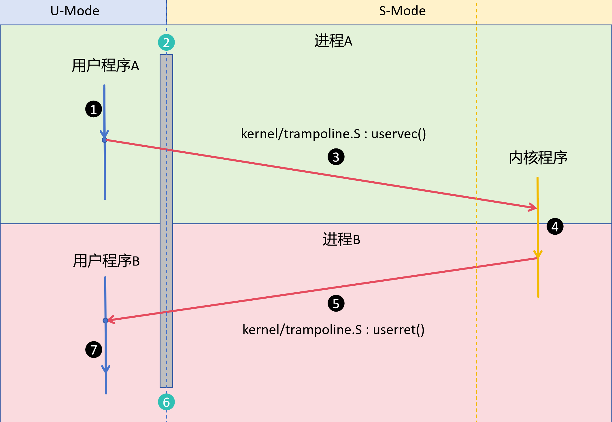
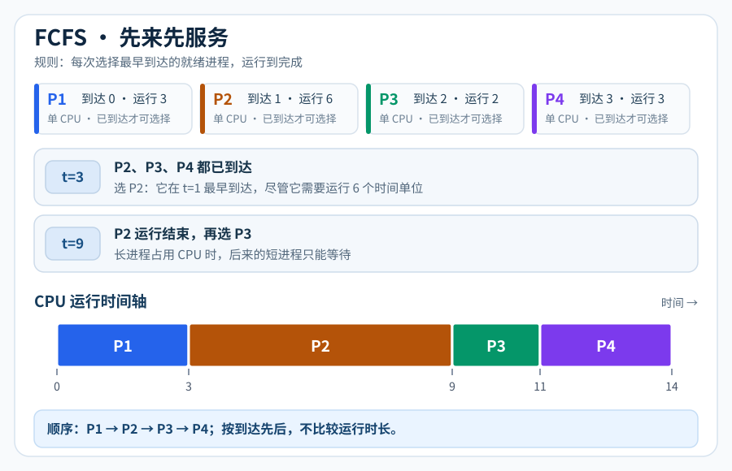
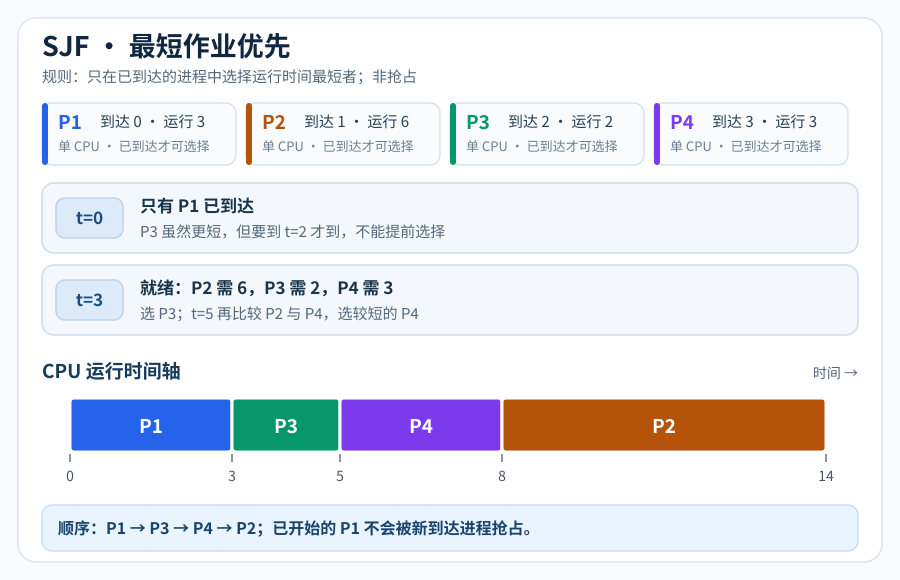
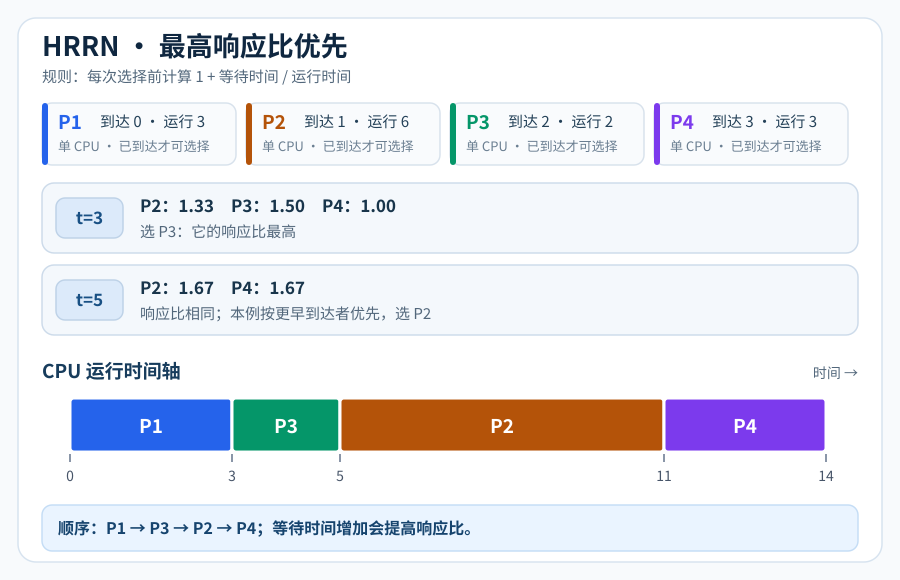
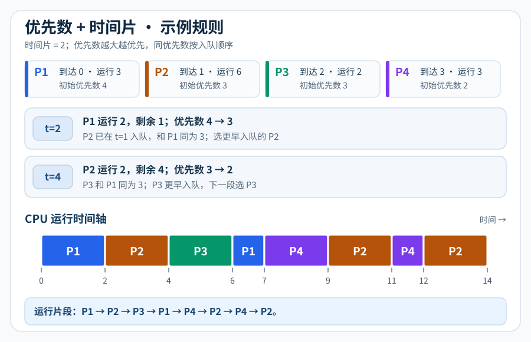

实验四：xv6进程调度
============================================================

在开始实验之前，提交 lab3 分支，合并到 master(main) 分支，并创建新的 lab4 分支：

.. code-block:: bash

  git add .
  git commit -m "lab3 done"
  git checkout master
  git merge lab3
  git checkout -b lab4

.. raw:: html

   <nav class="lab-progress" aria-label="实验流程">
     <a href="#lab4-prepare">01实验准备</a>
     <a href="#lab4-clockintr">02时钟中断处理</a>
     <a href="#lab4-swtch">03进程切换</a>
     <a href="#lab4-yield-task">04交替打印</a>
     <a href="#lab4-sched-algo">05进程调度算法</a>
   </nav>

完成本次实验后，应能够：

* 理解时钟中断
* 理解进程切换的现场保存与恢复
* 理解 xv6 的进程调度机制
* 理解 xv6 的启动流程
* 实现 ``yield`` 系统调用，并用两个进程验证主动让出 CPU 的过程
* 阅读四种调度策略，能根据到达时间、运行时间和优先数推演运行顺序

.. _lab4-prepare:

实验准备
~~~~~~~~~~~~~~~~~~~~~~~~~~~~~~~~~~~~~~~~~~~~~~~~~~~~~~~~~~~~

本实验主要参考以下文件：

``kernel/trap.c``
  查看 ``usertrap``、 ``devintr`` 函数。

``kernel/start.c``、 ``kernel/trap.c``
  查看 ``timerinit`` 与 ``clockintr``，理解下一次时钟中断怎样产生。

``kernel/proc.c``
  查看 ``yield``、 ``sched``、 ``scheduler`` 函数。

``kernel/swtch.S``
  理解进程切换过程。

.. _lab4-clockintr:

时钟中断处理
~~~~~~~~~~~~~~~~~~~~~~~~~~~~~~~~~~~~~~~~~~~~~~~~~~~~~~~~~~~~

RISCV的时钟中断可以认为是一个 **计数器 + 每个核独立的比较器**： ``mtime`` 持续递增，
每个 hart 有自己的 ``mtimecmp``。当 ``mtime >= mtimecmp`` 时，
该 hart 的时钟中断处于待处理状态；处理程序把比较值移到未来，为下一次中断设好时间。

.. code-block:: c
   :caption: kernel/start.c：timerinit() 首次设置定时器

   void
   timerinit()
   {
     // enable the sstc extension (i.e. stimecmp).
     w_menvcfg(r_menvcfg() | (1L << 63));
     // allow supervisor to use stimecmp and time.
     w_mcounteren(r_mcounteren() | 2);
     // ask for the very first timer interrupt.
     w_stimecmp(r_time() + 1000000);
   }

中断处理在 ``kernel/trap.c`` 的 ``devintr()`` 中，
通过 ``scause`` 判断是一次时钟中断，因此调用时钟中断处理程序 ``clockintr()``，
``2`` 是 ``devintr()`` 返回的值，在 xv6 中表示是时钟中断：

.. code-block:: c
   :caption: kernel/trap.c：devintr()

   else if(scause == 0x8000000000000005L){
    // timer interrupt.
    clockintr();
    return 2;
   }

处理时钟中断的方式就是为下一次中断设好时间：

.. code-block:: c
   :caption: kernel/trap.c：clockintr()

   void
   clockintr()
   {
     if(cpuid() == 0){
       acquire(&tickslock);
       ticks++;
       wakeup(&ticks);
       release(&tickslock);
     }
     // ask for the next timer interrupt. this also clears
     // the interrupt request. 1000000 is about a tenth
     // of a second.
     w_stimecmp(r_time() + 1000000);
   }

回到 usertrap()，如果 ``devintr()`` 返回 2，则说明是时钟中断，调用 ``yield()`` 切换进程。

.. code-block:: c
   :caption: kernel/trap.c：usertrap()

   // give up the CPU if this is a timer interrupt.
   if(which_dev == 2)
     yield();

.. _lab4-swtch:

进程切换
~~~~~~~~~~~~~~~~~~~~~~~~~~~~~~~~~~~~~~~~~~~~~~~~~~~~~~~~~~~~

从时钟中断到真实的进程切换
------------------------------------------------------------

沿图中的 A → 调度器 → B，依次看调度器是谁、现场怎样保存、下一个进程怎样选出。

   图概括了用户态 A 到用户态 B 的切换；CLINT 版本在②附近还会短暂进入 M 模式
   处理硬件定时器，③、⑤ 的红色箭头概括了中间的内核代码。

调度器现场
-----------------------------------------------------------

.. admonition:: 调度器属于 CPU，不属于某个进程

   .. code-block:: text

      cpus[CPU 编号] → struct cpu
                       ├─ proc ─────→ 当前运行的 struct proc（也可能为 0）
                       └─ context ──→ 调度器上次暂停的位置

      proc[NPROC] ───→ 共享的进程表；每项都有自己的 state、context、trapframe 和内核栈

每个 CPU 从 ``main()`` 进入自己的 ``scheduler()`` 循环。它有独立的内核执行现场，
但不是一个带 PID 的进程。``c->proc`` 才指向此刻占用该 CPU 的进程。

``mycpu()`` 用 ``tp`` 寄存器里的 hart 编号取得 ``&cpus[id]``；``myproc()``
在此基础上读取 ``c->proc``：

.. code-block:: c
   :caption: kernel/proc.c：myproc() 的关键代码

   push_off();                 // 读取期间禁止中断
   struct cpu *c = mycpu();
   struct proc *p = c->proc;
   pop_off();
   return p;

短暂关闭中断，是为了避免读到 CPU 编号后进程被抢占、迁移到另一 CPU。
因此 ``mycpu()`` 返回的是 **CPU 的记录**，不是一个“管理调度的进程”。

保存现场分析
-----------------------------------------------------------

图中 A 遇到时钟中断后，先沿 :ref:`实验三的陷入路径 <lab3-trap>` 进入内核：
``uservec`` 保存 A 的用户寄存器，``usertrap()`` 识别时钟中断并调用 ``yield()``。
接下来才发生内核执行流之间的切换。

.. admonition:: 两种现场分别放在哪里

   * ``A->trapframe``：用户态寄存器，由 ``uservec`` 保存，供 A 将来返回用户态。
   * ``A->context``：A 在内核里暂停的位置，由 ``swtch`` 保存。
   * ``c->context``：该 CPU 的调度器暂停的位置，也由 ``swtch`` 保存。

``yield()`` 把 A 改为 ``RUNNABLE``，再通过 ``sched()`` 交出 CPU：

.. code-block:: c
   :caption: kernel/proc.c：从 A 切回调度器（节选）

   p->state = RUNNABLE;                 // yield()
   sched();                             // yield()
   swtch(&p->context, &mycpu()->context); // sched()

``swtch`` 的两个参数分别是“保存到哪里”和“从哪里恢复”。看它在汇编中
怎样改变返回位置（``s0``～``s11`` 的同类指令已省略）：

.. code-block:: asm
   :caption: kernel/swtch.S：保存与恢复 ra、sp

   sd ra, 0(a0)      # 保存 A 的返回地址
   sd sp, 8(a0)      # 保存 A 的内核栈指针
   ld ra, 0(a1)      # 读取调度器的返回地址
   ld sp, 8(a1)      # 换回调度器的内核栈
   ret               # 回到调度器上次调用 swtch 的下一行

``context`` 只保存 ``ra``、``sp``、``s0``～``s11``：它们是 RISC-V
调用约定要求被调用者保留的寄存器；其他仍要用的值由编译器按调用约定
保存在内核栈等位置。这里不恢复用户寄存器，用户现场仍留在 ``trapframe``。

xv6 调度机制
-----------------------------------------------------------

调度器接回 CPU 后，并不是从 ``main()`` 重来，而是从上次调用
``swtch(&c->context, &A->context)`` 的下一行继续。

.. code-block:: c
   :caption: kernel/proc.c：scheduler() 的核心路径（省略中断处理）

   for (;;) {
     int found = 0;
     for (p = proc; p < &proc[NPROC]; p++) {
       acquire(&p->lock);
       if (p->state == RUNNABLE) {
         p->state = RUNNING;
         c->proc = p;
         swtch(&c->context, &p->context); // 进程交回 CPU 时从这里返回
         c->proc = 0;
         found = 1;
       }
       release(&p->lock);
     }
     if (found == 0)
       asm volatile("wfi");           // 等待中断，再扫描
   }

.. admonition:: 按图追踪 A → B

   #. 调度器曾选中 A，保存自己的现场到 ``c->context``，切入 ``A->context``。
   #. A 经时钟中断、``yield()``、``sched()``，保存 ``A->context`` 并恢复
      ``c->context``。调度器从上面那次 ``swtch`` 的下一行接着执行。
   #. 调度器清空 ``c->proc``、释放 A 的锁，继续扫描进程表。找到 ``RUNNABLE``
      的 B 后，设置 ``RUNNING`` 和 ``c->proc = B``，再切入 ``B->context``。
   #. B 从自己上次暂停的内核位置继续，最终由返回用户态的路径恢复
      ``B->trapframe``。如果 B 是首次运行，预设的 ``context.ra`` 使它先进入
      ``forkret``，再走返回用户态的路径。

进程锁跨越 ``swtch``，直到调度器接回 CPU 后才释放，防止另一 CPU 过早
运行同一进程。完整源码还通过 ``intr_on()/intr_off()`` 和 ``intena``
处理切换时的中断状态。默认调度器按进程表顺序寻找 ``RUNNABLE``

.. raw:: html

   

      
分析进程切换

      
请以 xv6 实现为例，分析一个进程A遇到时钟中断后，切换到另一个进程B的全过程。
      完整解释进程A保存了哪些上下文，保存在什么地方。又是如何恢复的进程B的上下文。
      结合代码片段分析。

   

.. _lab4-yield-task:

实现 yield 系统调用
~~~~~~~~~~~~~~~~~~~~~~~~~~~~~~~~~~~~~~~~~~~~~~~~~~~~~~~~~~~~

内核已有 ``yield()``，但用户程序不能直接调用内核函数。本作业要新增用户态入口，
让用户程序通过系统调用**主动让出 CPU**，再观察两个进程的运行。

接通系统调用
------------------------------------------------------------

参照 :ref:`实验三的系统调用路径 <lab3-poweroff>`，完成以下修改：

#. 在 ``kernel/syscall.h`` 为 ``SYS_yield`` 分配一个**未使用**的系统调用号。
#. 在 ``kernel/syscall.c`` 声明 ``sys_yield``，并加入 ``syscalls[]`` 分发表。
#. 在 ``kernel/sysproc.c`` 实现 ``sys_yield(void)``：调用内核已有的
   ``yield()``，待该进程再次运行后返回 ``0``。
#. 在 ``user/user.h`` 声明 ``int yield(void);``，在 ``user/usys.pl``
   加入 ``entry("yield");``，不要手改生成的 ``user/usys.S``。

调用链应能从用户态的 ``yield()`` 一直追踪到
``sys_yield() → yield() → sched() → swtch() → scheduler()``。

两个进程交替打印
------------------------------------------------------------

编写 ``user/ab.c``，加入 ``Makefile`` 的 ``UPROGS``。
父进程打印 ``A``，子进程打印 ``B``；两者每次打印后
都调用新增的 ``yield()``。预期字符序列为：

.. code-block:: text

   ABABABABABABABABABAB

行为如下：

.. code-block:: text

   父进程：while(1) {打印 A → yield()}
   子进程：while(1) {打印 B → yield()}

.. raw:: html

   

      
实现两个进程交替打印

      
完成两个进程交替打印，并截图输出的内容。
      由于进程切换可能过快，需要适当调整 yield() 的调用频率。
      可以在printf后添加 pause(1) 进行延迟。

   

.. _lab4-sched-algo:

进程调度算法
~~~~~~~~~~~~~~~~~~~~~~~~~~~~~~~~~~~~~~~~~~~~~~~~~~~~~~~~~~~~~

本节用于理解四种调度思想， **不要求在 xv6 中实现它们**。
前面分析的 xv6 ``scheduler()`` 按进程表扫描 ``RUNNABLE``；下面的服务时间、
响应比和优先数是为了比较算法而给出的假设数据，不是 xv6 默认调度器的选择依据。

前三张图使用同一组进程，均假设单 CPU、运行期间不阻塞，时间单位相同：

.. list-table:: 阅读示例：到达时间与所需运行时间
   :header-rows: 1
   :widths: 20 40 40

   * - 进程
     - 到达时间
     - 运行时间
   * - P1
     - 0
     - 3
   * - P2
     - 1
     - 6
   * - P3
     - 2
     - 2
   * - P4
     - 3
     - 3

先来先服务 FCFS
------------------------------------------------------------

每次选择 **最早到达** 的就绪进程，运行到完成。图中 P1 在 ``t=0`` 
开始运行；到 ``t=3`` 时 P2、P3、P4 都已到达，因此先选 P2。
长进程 P2 运行期间，后面的短进程也必须等待。

   FCFS：按到达顺序运行；P2 占用 ``t=3～9``，P3 只能继续等待。

最短作业优先 SJF
------------------------------------------------------------

每次从 **已经到达**的进程中选择运行时间最短者，运行到完成。
``t=0`` 时只有 P1，不能提前选择尚未到达的 P3；``t=3`` 时
P3 最短，因此它排在 P2 前面。这里讨论的是**非抢占式** SJF。

   SJF：只在每次选择时比较已到达的进程；已开始运行的 P1 不被抢占。

最高响应比优先 HRRN
------------------------------------------------------------

每次选择前重新计算就绪进程的 **响应比Ri(t)**，取最大者运行到完成：

.. math::

   R_i(t) = \frac{t-A_i+B_i}{B_i} = 1+\frac{t-A_i}{B_i}

其中 ``A_i`` 是到达时间， ``B_i`` 是运行时间， ``t-A_i`` 是在 **当前选择时刻**
已经等待的时间。 ``t=3`` 时 P3 的响应比为 ``1+1/2=1.5``，高于 P2 的
``1+2/6≈1.33``； ``t=5`` 时 P2 与 P4 都约为 ``1.67``，
本例按更早到达者优先，选择 P2。

   HRRN：等待越久，响应比会上升；每次选择时重新计算。

基于最高优先数的循环轮转调度
------------------------------------------------------------

仍使用上表的 P1～P4，并额外设初始优先数分别为 ``4、3、3、2``，
时间片为 ``2``。优先数越大越先运行；每次最多运行一个时间片，
未完成时优先数减 ``1`` 并重新入队。

图中按以下规则推演：

#. 初次到达的进程按到达时间、输入顺序入队；
#. 每次选择当前优先数最大的就绪进程；相同优先数选择入队最早者；
#. 运行时长为“时间片与剩余运行时间的较小值”；新进程到达不会中断当前时间片；
#. 时间片结束时，将截至该时刻的新到达进程先按到达时间、输入顺序入队；
#. 若当前进程已完成，记录完成时间并离开就绪队列；
#. 若尚未完成，将优先数减 1，赋予新的入队序号，再放回就绪队列；

同优先数的“轮转”依据是 **入队顺序**，不能每次都按进程号选择。
重新入队的进程应排在已经处于相同优先数的进程之后。

例如 ``t=2`` 时 P1 未完成，优先数从 ``4`` 降到 ``3`` 并重新入队；
P2 已在 ``t=1`` 以优先数 ``3`` 入队，因此下一次先运行 P2。

   每段最多运行 ``2`` 个时间单位；同优先数按入队先后选择。

.. raw:: html

   

      
理解常见进程调度算法

      
不需要修改 xv6 调度器，也不需要编写这四种算法的程序。
      请对照四张图，写出每种算法的选择依据、可能的优点与问题；
      重点解释为什么同一组 P1～P4 会得到不同的运行顺序。

   

