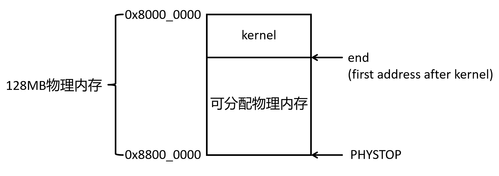

实验五：内存管理
================================================================================

本次实验围绕 xv6 的内存管理展开，由两个相互衔接的部分组成：

* **第一部分：物理内存管理。** 阅读原始物理页分配器，实现伙伴系统与连续物理页分配。
* **第二部分：页表与写时复制。** 观察地址映射，在第一部分的分配器基础上实现 COW ``fork()``。

两部分共同组成一次 Lab5 大作业，使用同一份 xv6 工程和 ``lab5`` 分支，
统一整理实验报告并提交。第一部分提供物理页分配与回收能力，
第二部分通过页表、权限和共享引用管理，实现进程地址空间的隔离与按需复制。

.. raw:: html

   <nav class="lab-progress" aria-label="Lab5 总体流程">
     <a href="#lab5-prepare">开始前保存代码与创建分支</a>
     <a href="#lab5-buddy">第一部分物理内存管理</a>
     <a href="#lab5-part2-cow">第二部分页表与写时复制</a>
   </nav>

.. _lab5-prepare:

.. rubric:: 实验准备与代码管理

以下命令在 **xv6-riscv 源码仓库** 中执行，而不是课程网站的文档仓库。
先确认当前位于已经完成 Lab4 的分支，保存并提交已有成果，再从当前成果创建 ``lab5``：

.. code-block:: bash

   git branch --show-current
   git status --short
   git add kernel user Makefile
   git commit -m "lab4 done"
   git switch -c lab5

如果 Lab4 已经提交，可以跳过 ``git add`` 和 ``git commit``；
如果 ``lab5`` 分支已经存在，直接执行 ``git switch lab5``。
进入第二部分时继续使用该分支，不再另建 Lab6 分支。

.. _lab5-buddy:

第一部分：物理内存管理
~~~~~~~~~~~~~~~~~~~~~~~~~~~~~~~~~~~~~~~~~~~~~~~~~~~~~~~~~~~~

本部分先理解物理页分配，再按元数据、初始化、申请释放和接口兼容的顺序实现伙伴系统。
完成测试后保存阶段性提交，再继续第二部分。

.. raw:: html

   <nav class="lab-progress" aria-label="第一部分实验流程">
     <a href="#lab5-buddy-pages">1.1原始物理页分配器</a>
     <a href="#lab5-buddy-theory">1.2伙伴系统原理</a>
     <a href="#lab5-buddy-metadata">1.3准备与元数据</a>
     <a href="#lab5-buddy-init">1.4初始化</a>
     <a href="#lab5-buddy-alloc-free">1.5分配与合并</a>
     <a href="#lab5-buddy-compat">1.6单页接口</a>
     <a href="#lab5-buddy-tests">1.7验证与提交</a>
   </nav>

.. _lab5-buddy-pages:

1.1 xv6 的物理页分配方式
--------------------------------------------------------------------------------

在 xv6 中，物理内存被划分为 4 KiB 的页。内核映像结束位置 ``end``
之后，从 ``PGROUNDUP(end)`` 开始的完整页可供分配；``PHYSTOP``
是内存上界，不是可分配页的起始地址。原始 ``kalloc()`` 和 ``kfree()``
只管理单页，使用一条单向链表维护空闲页，无法保证连续物理页的分配。

   内核映像结束位置 ``end`` 之后，从下一页边界到 ``PHYSTOP`` 之前的完整页可分配。

.. raw:: html

   

      
任务 1：读懂原始物理页分配器

      
阅读原始 <code>kernel/kalloc.c</code>，画出
      <code>kinit() → freerange() → kfree()</code> 建立空闲链表的过程，
      再说明 <code>kalloc()</code> 如何取出一页、<code>kfree()</code> 如何归还一页。
      在实验报告中画出至少三页的链表变化，并分析单页头插分配的优点与局限。

   

.. admonition:: 提示：先分清地址和页号
   :class: myhint

   ``end`` 是地址，不一定在页边界；``PGROUNDUP(end)`` 才是第一张
   可能被分配的完整页的起点。原始 ``kalloc()`` 只取链表头，不会遍历
   链表搜索“最合适”的页。

.. _lab5-buddy-theory:

1.2 伙伴系统
--------------------------------------------------------------------------------

完成本部分后，应能够解释以下问题：

* 为什么“两个空闲块相邻”仍不足以保证它们可以合并？
* 申请连续的 ``2^n`` 页时，怎样找到并拆分更大的块？
* 释放一个块时，怎样计算它的伙伴，并逐级合并？
* xv6 原有的 ``kalloc()`` 和 ``kfree()`` 怎样兼容新的分配器？

从单页分配到块分配
^^^^^^^^^^^^^^^^^^^^^^^^^^^^^^

假设物理内存被划为等大的页，并从 0 开始编号。伙伴系统把页组织为
**大小为 2 的幂、起点按块大小对齐** 的连续块。块的“阶”表示它包含多少页：

.. list-table:: 阶数与块大小（每页 4 KiB）
   :header-rows: 1
   :widths: 20 20 25

   * - 阶数
     - 连续页数
     - 块大小
   * - 0
     - 1
     - 4 KiB
   * - 1
     - 2
     - 8 KiB
   * - 2
     - 4
     - 16 KiB
   * - 3
     - 8
     - 32 KiB

例如，第 2 阶块可以是页 ``[8..11]``，它的起点 8 是 4 的倍数。
页 ``[12..15]`` 是它的伙伴：两块大小相同，并且恰好组成以 8 为起点的
第 3 阶块 ``[8..15]``。伙伴并非任意相邻块：第 2 阶的
``[4..7]`` 与 ``[8..11]`` 虽然相邻，却不能合并成正确对齐的
第 3 阶块。

对首页页号 ``i``、阶数 ``n``，伙伴首页页号为：

.. code-block:: text

   buddy(i, n) = i XOR (1 << n)

``XOR`` 是按位异或。它翻转区分同一大块左右两半的那一位：
``8 XOR 4 = 12``，``12 XOR 4 = 8``。使用此公式的前提是页号
从同一段对齐的物理内存起点计算，且每个块按自身大小对齐。

需要保存哪些状态
^^^^^^^^^^^^^^^^^^^^^^^^^^^^^^

理论上需要为每一阶维护一条空闲块链表 ``freelist[n]``，还要知道一个块是否
空闲、属于哪一阶。实现时可只在**块的首页**记录阶数和空闲状态；块内其他页
不是独立块头。维护如下不变量：

#. 一个空闲块只出现在与其阶数相同的链表中；
#. 两个空闲的同阶伙伴应合并为一个高一阶块；
#. 已分配块不会出现在任何空闲链表中；
#. 每个块的首页、大小和对齐方式一致。

第二条说明合并应持续进行，而不是只检查一次。只有保持这些不变量，
分配器才能通过查找某阶链表判断是否有足够大的连续区域。

.. admonition:: 提示：阶数不是块的数量
   :class: myhint

   第 0～15 阶共有 16 种大小，但同一阶可以同时存在许多块。
   例如四个互不相邻的空闲页都是第 0 阶块，分别拥有自己的块首页；
   不能只用一条“第 0 阶状态”表示它们。

申请：向上查找，向下拆分
^^^^^^^^^^^^^^^^^^^^^^^^^^^^^^

申请第 ``n`` 阶块时，先查看 ``freelist[n]``。如果为空，就向更高阶
查找；若找到第 ``m`` 阶块，其中 ``m > n``，便反复平分：

.. code-block:: text

   从第 3 阶的 [8..15] 申请第 1 阶块

   [8..15]  第 3 阶
     ├─ [8..11]   第 2 阶，继续拆
     │    ├─ [8..9]    第 1 阶，返回
     │    └─ [10..11]  第 1 阶，放回空闲链表
     └─ [12..15] 第 2 阶，放回空闲链表

若所有不小于 ``n`` 阶的链表都为空，申请失败。这里返回的两页在
**物理地址** 上连续；它们是否被映射到用户虚拟地址，是页表管理的另一件事。

释放：检查伙伴，向上合并
^^^^^^^^^^^^^^^^^^^^^^^^^^^^^^

释放第 ``n`` 阶块时，先验证地址、对齐、阶数及“已分配”状态，再计算
同阶伙伴。只有伙伴 **空闲且同阶**，才能从空闲链表摘除它，把两块合为
第 ``n+1`` 阶。新块取两者中较低的首页页号，然后继续检查更高阶伙伴。
无法再合并时，将最终块插入其所属阶数的链表。

例如先释放 ``[8..11]``、再释放 ``[12..15]``：

.. code-block:: text

   [8..11]  +  [12..15]  →  [8..15]
   第 2 阶     第 2 阶       第 3 阶

若 ``[12..15]`` 正在使用，``[8..11]`` 必须作为第 2 阶块保留；
“地址相邻”不能替代对伙伴状态的检查。

.. raw:: html

   

      
任务 2：手工推演拆分与合并

      
以页号 8～15 为例，画出从一个第 3 阶空闲块申请第 1 阶块后，
      各阶空闲链表中剩余的块；再推演释放时怎样逐级合并。
      分别计算页号 8 和 12 作为第 2 阶块首页时的伙伴。
      最后回答：连续的 2 MiB 物理内存需要多少页、应申请第几阶？

   

代价与适用场景
^^^^^^^^^^^^^^^^^^^^^^^^^^^^^^

每次查找、拆分和合并最多跨越最高阶数那么多级。若空闲链表支持根据节点
直接摘除伙伴，结构操作的复杂度为 ``O(log N)``，其中 ``N`` 是页数。
实现还可能为调试而填充整块内存；这部分耗时与块大小成正比。

伙伴系统适合按 2 的幂申请连续物理页，也能在释放后恢复大块。它的代价是
**内部碎片**：申请 5 页需要占用第 3 阶的 8 页块，暂时浪费 3 页。
单一全局锁还可能在多核频繁分配时形成争用。

.. _lab5-buddy-metadata:

1.3 改造准备与元数据
--------------------------------------------------------------------------------

开始改造前，对照以下文件确认内存范围和原有单页调用：

.. list-table:: 源码阅读顺序
   :header-rows: 1
   :widths: 35 65

   * - 文件
     - 关注内容
   * - ``kernel/kernel.ld``
     - ``end`` 是内核映像结束位置；之前的页不得交给分配器。
   * - ``kernel/memlayout.h``
     - ``KERNBASE`` 和 ``PHYSTOP`` 确定管理的物理地址范围。
   * - ``kernel/riscv.h``
     - ``PGSIZE`` 为 4096，``PGROUNDUP`` 用于页对齐。
   * - ``kernel/kalloc.c``
     - ``kinit()``、``kalloc()``、``kfree()`` 是本部分的改造对象。
   * - ``kernel/vm.c``
     - ``uvmalloc()``、``uvmunmap()`` 展示单页接口的调用方式。

本实验的 ``PHYSTOP - KERNBASE`` 为 128 MiB，即 ``2^15`` 页，
因此实现定义 ``MAX_ORDER = 15``。内核已经占用部分内存，实际空闲范围
未必包含一个完整的第 15 阶块。

按下面的顺序动手：**先建立元数据和链表操作，再初始化空闲页，
然后实现申请与释放，最后接回原有单页接口并验证**。每一步都保持
“块首页的阶数、空闲状态、所属链表”三者一致。

替换空闲链表并建立元数据
^^^^^^^^^^^^^^^^^^^^^^^^^^^^^^^^^^^^^^^^^^^^^^^^^^^^^^^^^^^^

在 ``kernel/kalloc.c`` 中，把单个 ``freelist`` 改为
``freelist[MAX_ORDER + 1]``。空闲块首页用 ``struct run`` 存储
``next`` 和 ``prev``，这样已知伙伴地址时可以直接从链表摘除伙伴。
再增加两个以物理页号为索引的数组：

.. code-block:: c

   #define NPAGES ((PHYSTOP - KERNBASE) / PGSIZE)
   #define MAX_ORDER 15

   struct run {
     struct run *next;
     struct run *prev;
   };

   struct {
     struct spinlock lock;
     struct run *freelist[MAX_ORDER + 1];
     signed char order[NPAGES];
     uchar free[NPAGES];
   } kmem;

``order[i]`` 只记录块首页的阶数；块内部页和保留页记为 ``-1``。
``free[i]`` 区分空闲块头和已分配块头。``pageindex(pa)`` 将地址转为页号：

.. code-block:: c

   i = ((uint64)pa - KERNBASE) / PGSIZE;

元数据是内核的静态数组，位于 ``end`` 之前，不会被当作空闲页分配。
``pushfree()`` 负责插入空闲链表，``removefree()`` 负责摘除；
它们与元数据更新都由 ``kmem.lock`` 保护。
``NPAGES`` 是从 ``KERNBASE`` 到 ``PHYSTOP`` 的总页数，
**不是当前空闲页数**。数组按页号直接索引，查询伙伴状态无需扫描链表。

.. raw:: html

   

      
任务 3：建立分阶空闲链表和元数据

      <ol>
         <li>在 <code>kernel/kalloc.c</code> 定义 <code>NPAGES</code>、
         <code>MAX_ORDER</code>、各阶空闲链表与页状态数组。</li>
         <li>实现 <code>pageindex()</code>，把物理地址换算为相对
         <code>KERNBASE</code> 的页号。</li>
         <li>实现 <code>pushfree()</code> 和 <code>removefree()</code>：
         插入或摘除指定阶数的块，同时维护链表指针与 <code>free[]</code>。</li>
      </ol>
      
完成后，请解释为什么合并时已经知道伙伴地址，却仍需要双向链表。

   

.. admonition:: 小心：链表指针写在空闲块内
   :class: mycaution

   ``struct run`` 占用的是空闲块首页开头的字节。块被分配后，
   这些字节属于调用者，不能继续读取 ``next`` 或 ``prev``。
   若释放时要用 ``memset`` 填充页面，应先核对元数据，再填充，
   最后用 ``pushfree()`` 写入新的链表指针。

.. _lab5-buddy-init:

1.4 改造初始化
--------------------------------------------------------------------------------

``kinit()`` 先把全部 ``order[]`` 设为 ``-1``，然后从
``PGROUNDUP(end)`` 起逐页初始化，到 ``PHYSTOP`` 为止。
每个新加入的页先视为第 0 阶块，再交给 ``kfree_pages(p, 0)``。
这会立即尝试与已经加入的空闲伙伴合并。``PHYSTOP`` 本身是上界，
不代表一页可分配内存。

从第一张空闲页推演
^^^^^^^^^^^^^^^^^^^^^^^^^^^^^^^^^^^^^^^^^^^^^^^^^^^^^^^^^^^^^^^^^^^^^^^^^^^^^^^^

为了看清每一步，假设 **第一个可分配页的页号是 8**。页号 8 按两页、
四页和八页块的大小对齐，因此随后加入的页 9、10、11 能演示逐级合并。
这里的页号由 ``pageindex(pa)`` 计算，是相对 ``KERNBASE`` 的页号；
它不是从物理地址 0 开始计算的页号。

**第一次循环：加入页 8。** ``kinit()`` 先设置 ``order[8] = 0``，
表示页 8 暂时是一个第 0 阶块的首页。``free[8]`` 初始为 0。
``kfree_pages()`` 计算第 0 阶伙伴：``8 XOR 1 = 9``。页 9 尚未加入，
所以不能合并。``pushfree()`` 将页 8 头插到 ``freelist[0]``，
并设置 ``order[8] = 0``、``free[8] = 1``。

**第二次循环：加入页 9。** ``kinit()`` 暂时设置 ``order[9] = 0``，
而 ``free[9]`` 仍为 0。``kfree_pages()`` 算出
``9 XOR 1 = 8``；页 8 是空闲的第 0 阶伙伴，因此执行以下动作：

#. ``removefree(8, 0)`` 把页 8 从 ``freelist[0]`` 摘除，并将
   ``free[8]`` 改为 0；
#. 两页合成第 1 阶块。页 9 不再是块首页，故 ``order[9] = -1``；
#. 新块首页取较低页号 8，局部变量 ``order`` 从 0 增至 1，
   并将 ``order[8]`` 更新为 1；
#. ``pushfree(8, 1)`` 把新块 ``[8..9]`` 头插到
   ``freelist[1]``，设置 ``free[8] = 1``。

注意，代码增加的是 ``kfree_pages()`` 的局部变量 ``order``，
然后将新阶数写回块首页；并非直接对 ``order[8]`` 做自增。
页 9 的 ``free[9]`` 始终为 0，因为它不是空闲块的首页。

**第三、四次循环：加入页 10 和 11。** 加入页 10 时，其第 0 阶伙伴
``10 XOR 1 = 11`` 尚未加入，因此页 10 暂留在 ``freelist[0]``。
加入页 11 后，先将 ``[10]`` 与 ``[11]`` 合成第 1 阶块
``[10..11]``。此时继续计算新块的第 1 阶伙伴：
``10 XOR 2 = 8``，于是 ``[10..11]`` 又与空闲的
``[8..9]`` 合为第 2 阶块 ``[8..11]``。

.. code-block:: text

   加入页 8 后：   freelist[0] → [8]          order[8]=0, free[8]=1
   加入页 9 后：   freelist[1] → [8..9]       order[8]=1, free[8]=1
   加入页 10 后：  freelist[0] → [10]
                   freelist[1] → [8..9]
   加入页 11 后：  freelist[2] → [8..11]      order[8]=2, free[8]=1

最后一行中，页 9、10、11 都是块内页，``order[]`` 为 ``-1``。
这也说明 ``freelist[n]`` 的每个节点代表一个 ``2^n`` 页的块，
并非链表节点之间逐页连接。

**对齐是这段推演的前提。** 如果第一个可分配页是页号 9，
那么页 9 的第 0 阶伙伴是页 8，而页 10 的伙伴是页 11。
页 9 与 10 虽然相邻，加入第二页时也不能合并。
真实的 ``PGROUNDUP(end)`` 不保证落在页号 8 这样的边界上，
所以初始化得到的会是若干个不同阶数的空闲块。

``pageindex()`` 负责从地址得到页号，供元数据访问和伙伴计算使用。
``pushfree()`` 把一个块插入相应阶数链表；
``removefree()`` 则摘除 **指定的块**，可能要修改链表头，也可能要连接
它的前后节点。合并时已经通过异或算出了伙伴地址，双向链表让中间节点也能
直接摘除，不必从链表头寻找前驱。

.. raw:: html

   

      
任务 4：让 kinit 建立伙伴系统

      
初始化锁和 <code>order[]</code>，从 <code>PGROUNDUP(end)</code>
      起逐页加入空闲区域。每页在交给 <code>kfree_pages(p, 0)</code> 前，
      先把该页登记为第 0 阶、尚未空闲的块头。
      在实验报告中按页号 8～11 复现上面的四次循环，
      写出每次循环后非空的 <code>freelist[]</code>。

   

.. admonition:: 小心：按同一个基准计算伙伴
   :class: mycaution

   伙伴异或运算使用的是相对 ``KERNBASE`` 的页号，而不是
   ``(pa - end) / PGSIZE``。``end`` 不一定按大块对齐；
   若以它作为页号零点，相邻块可能被错误地认作伙伴。

.. _lab5-buddy-alloc-free:

1.5 实现多页申请和释放
--------------------------------------------------------------------------------

``kalloc_pages(order)`` 按理论部分的“向上查找、向下拆分”实现：
从请求阶数开始向上查找；没有合适块时返回 ``0``。找到块后，
用 ``removefree()`` 将其取出。只要当前阶数仍大于请求阶数，就将
当前阶数减一，保留左半块继续拆，把右半块用 ``pushfree()``
放回对应链表。最后把左半块记录为已分配的目标阶块，再返回其首页地址。
每次拆分都要更新两个子块的元数据，不能只修改链表。

``kfree_pages(pa, order)`` 先检查阶数、地址范围、块对齐和分配状态，
再用页号异或计算伙伴。如果伙伴越界、不空闲或阶数不同，就停止合并；
否则用 ``removefree()`` 摘除伙伴，清理不再作为块首页的元数据，
以较低页号为新块首页继续向高阶合并。最后通过 ``pushfree()``
把合并后的块放回对应链表。错误阶数或重复释放会触发 ``panic``。

源码沿用 xv6 的调试填充值：申请后用 ``5`` 填充，释放时用 ``1``
填充。它们不是零初始化；例如 ``uvmalloc()`` 仍要自行清零用户页。

.. raw:: html

   

      
任务 5：实现拆分与合并

      <ol>
         <li>实现 <code>kalloc_pages(order)</code>：处理非法阶数和无可用块，
         完成向上查找、逐级拆分、元数据更新，并返回按块大小对齐的地址。</li>
         <li>实现 <code>kfree_pages(pa, order)</code>：检查地址与分配状态，
         根据伙伴页号逐级合并；只有空闲且同阶的伙伴才能被摘除。</li>
         <li>保护对空闲链表和页状态的共同修改；检查所有提前返回路径是否正确释放锁。</li>
      </ol>
      
用页号 8～15 的例子逐行对照代码，说明每次拆分或合并后
      <code>order[]</code>、<code>free[]</code> 和 <code>freelist[]</code> 的变化。

   

.. admonition:: 小心：传入的阶数必须与实际分配阶数相同
   :class: mycaution

   ``kalloc_pages(2)`` 返回的是一个四页块，释放时必须调用
   ``kfree_pages(pa, 2)``；不能拆成四次 ``kfree()``。
   对齐也要按 **整个块的大小** 检查：第 2 阶是 16 KiB 对齐，
   第 9 阶是 2 MiB 对齐。合并时还应检查伙伴页号是否小于
   ``NPAGES``。

.. _lab5-buddy-compat:

1.6 保留单页接口
--------------------------------------------------------------------------------

在 ``kernel/defs.h`` 声明 ``kalloc_pages()``、
``kfree_pages()``，并使原有接口成为第 0 阶包装：

.. code-block:: c

   void *kalloc(void) { return kalloc_pages(0); }
   void kfree(void *pa) { kfree_pages(pa, 0); }

因此 ``kernel/vm.c``、``kernel/proc.c`` 等单页调用者无需修改。
若新调用者需要 4 个连续物理页，应配对使用：

.. code-block:: c

   void *pa = kalloc_pages(2);
   if(pa != 0){
     // 使用 [pa, pa + 4*PGSIZE)
     kfree_pages(pa, 2);
   }

不能把此块拆成四次 ``kfree()``；分配器记录它是一个第 2 阶块。

.. raw:: html

   

      
任务 6：接回 xv6 原有调用

      
在 <code>kernel/defs.h</code> 声明两个新接口；
      用第 0 阶包装实现 <code>kalloc()</code> 和 <code>kfree()</code>。
      保持 <code>kernel/vm.c</code>、<code>kernel/proc.c</code> 等
      原有单页调用可以直接编译、运行。说明为什么页表能够把不连续的
      物理页映射为进程看到的连续虚拟地址。

   

.. _lab5-buddy-tests:

1.7 验证与提交
--------------------------------------------------------------------------------

先在 xv6 目录运行 ``make qemu``，确认内核启动并出现 ``$``
提示符。这验证原有单页接口至少能够服务页表、进程内核栈等调用者。
如果启动时出现 ``panic``，先检查 ``kinit()`` 是否在页表建立之前
完成初始化，以及首次加入空闲页时元数据是否已经设置。

随后在初始化全部空闲页之后临时调用多页接口，至少验证第 0、1、2 阶。
例如申请第 2 阶块时，应能访问第 4 页的最后一个字节，再用原阶数释放：

.. code-block:: c

   char *p = kalloc_pages(2);
   if(p == 0 || ((uint64)p - KERNBASE) % (4 * PGSIZE) != 0)
     panic("buddy test");
   p[4 * PGSIZE - 1] = 42;
   kfree_pages(p, 2);

测试前后可统计各阶空闲链表所代表的总页数：
``总空闲页数 = Σ(第 n 阶空闲块数 × 2^n)``。
申请后该数应减少，完整释放后应恢复。这个统计只能检查页数是否丢失；
要验证**合并**，还应在调试时观察释放前后各阶链表的块数与块首页变化，
确认两个同阶伙伴被摘除并形成高一阶块。不要仅凭 ``make qemu``
能启动，就认定多页申请与合并已经正确。

.. raw:: html

   

      
任务 7：验证伙伴分配器

      
提供 <code>make qemu</code> 启动到 shell 的截图，
      分别记录第 0、1、2 阶申请返回的地址和对齐结果；
      对比申请前、申请后、释放后的空闲页总数。
      在实验报告中给出页号 8～11 的初始化推演，
      记录一次拆分和一次合并前后相关阶数的空闲块变化，
      并解释为什么申请 5 页需要占用 8 页。

   

.. admonition:: 测试提示
   :class: myhint

   将临时测试放在 ``kinit()`` 完成所有空闲页初始化之后；
   不要在初始化到一半时申请大块。测试中故意传错阶数或重复释放会触发
   ``panic``，应单独验证，避免和正常启动测试混在一起。
   验证结束后移除临时测试代码。

最后思考：如果要封装“申请任意页数”的接口，需要由谁记录实际分配的
阶数，以便日后正确释放？

保存第一部分的阶段性成果
^^^^^^^^^^^^^^^^^^^^^^^^^^^^^^^^^^^^^^^^^^^^^^^^^^^^^^^^^^^^^^^^^^^^^^^^^^^^^^^^

完成上述验证并移除临时测试后，在 xv6 工程中保存阶段性提交：

.. code-block:: bash

   git status --short
   git add kernel/kalloc.c kernel/defs.h
   git commit -m "lab5: implement buddy allocator"

若另外新增了需要保留的测试源码，也应一并加入提交。
报告中保留第一部分的测试记录；随后继续在 ``lab5`` 分支完成第二部分，
沿用已有的伙伴系统和单页接口。

继续在本分支阅读 :ref:`lab5-part2-cow`，在伙伴分配器上实现页表观察与写时复制。

.. include:: lab5_part2.rst
